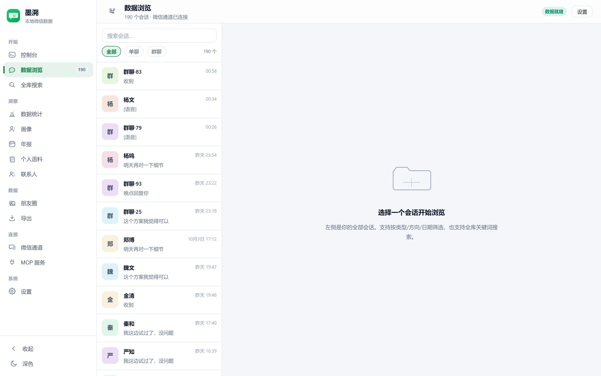
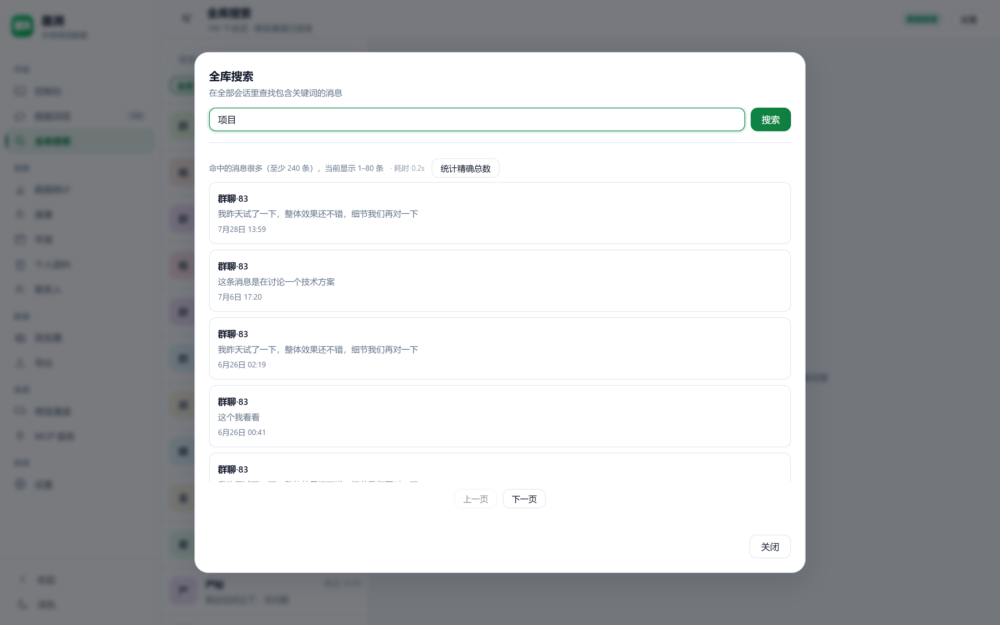
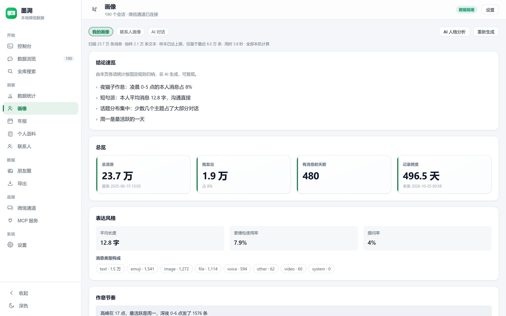
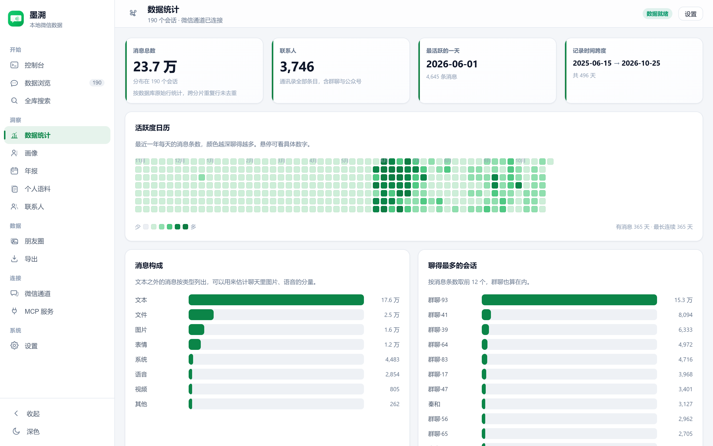
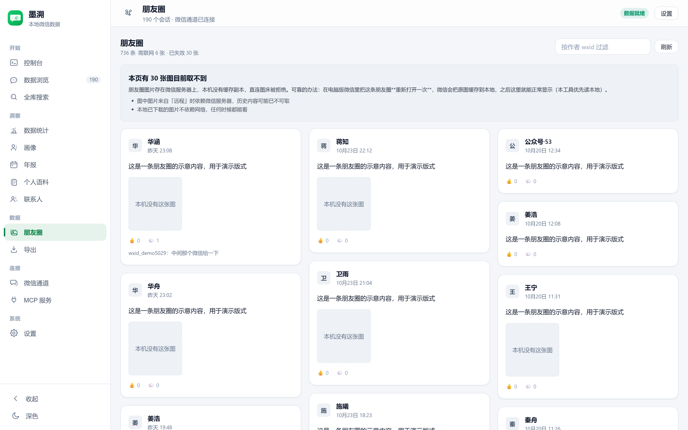

# 墨溯 mosu

> 本地微信数据解密与导出工具 —— 自有 SQLCipher 4 引擎，零 DLL、零网络、零授权检查。

一句话：把微信电脑端那些打不开的 `.db` 文件，变成你能读、能搜、能统计、能导出的数据。

```bash
pip install -r requirements.txt
python cli/mosu.py init --db-path "<微信数据目录>" --key <64位hex>
python cli/mosu.py sessions
```

---

## 界面

<p align="center">
  
</p>

<p align="center">
  
  
</p>

<p align="center">
  
  
</p>

> 截图取自 `MOSU_DEMO=1` 演示模式：姓名、群名、wxid、账号、聊天正文均已替换为示意内容，
> 数字与结构是真实的。生成方式见 [`scripts/shots.py`](scripts/shots.py)。

<table>
<tr><td width="50%">

**能做什么**
- 数据浏览：190 会话、23 万条消息，图片语音都能看
- 全库搜索：关键词秒出，支持翻页与精确计数
- 数据统计 / 年报：活跃度、时段、词频
- 个人画像：一句话概括你的说话风格
- 联系人 / 朋友圈 / 导出 / 设置

</td><td width="50%">

**不做什么**
- 不联网、不上传、不做云端同步
- 不注入 DLL、不改微信任何文件
- 不内置任何授权检查或账号体系

</td></tr>
</table>

---

## 为什么做这个

微信电脑版把聊天数据存在 SQLCipher 4 加密的 SQLite 里，密钥在它自己进程的内存里。
市面上的现成工具要么是闭源黑盒、要么带授权锁、要么直接调用官方 DLL ——
作者不干了、锁触发了、或者你只是想在自己的脚本里读一条消息，就只能干瞪眼。

墨溯把这套链路**完整自研**：

| 层 | 做法 |
|---|---|
| 加密层 | 自有 SQLCipher 4 实现（PBKDF2-HMAC-SHA512 × 256030，AES-256-CBC + HMAC-SHA512） |
| 解析层 | zstd 解压 + protobuf + XML，消息/联系人/群/语音/视频/朋友圈全格式 |
| 媒体层 | 图片 V0（XOR）与 V2（私有容器，AES-128-ECB + 尾部 XOR）解密 |
| 应用层 | CLI 命令集 + MCP Server，五种输出格式 |

加密层用的是**开源社区公开的参数**（不重造密码学），其余全部自有代码。
**没有任何 DLL 注入、没有进程操作、没有网络请求。** 纯本地、纯只读。

## 特性

- **全库解密**：`session` / `contact` / `message` / `media` / `sns`，多分片自动合并去重
- **消息查询**：按会话、类型（文本/图片/语音/视频/文件/表情）、方向、时间段、游标翻页
- **全文搜索**：逐条解压后匹配，搜得到压缩消息体里的词
- **统计**：全局概览、联系榜、小时/星期/月分布、单人统计、关键词、群成员榜
- **画像蒸馏**：全库个人画像 + 单联系人深度画像（作息/社交图谱/话题/情感曲线/亲密度信号）；
  **配了大模型自动追加「AI 人格分析」章节**（六维度，每条判断带逐字引文证据 + 反例 + 置信度，
  引文对不上真实消息的会被校验器丢弃——防编造；`--no-ai` 可关，没配大模型自动降级纯统计）
- **个人 bot 素材**：本人发言语料包（jsonl + 按会话分段）+ 风格画像
- **数字分身服务**（`mosu bot`）：云端 LLM（OpenAI 兼容，任意后端可换）+ RAG 从你的历史发言检索风格参考 + 规则硬校验（AI 腔禁词/长度/感叹号/照抄检测，不达标自动带反馈重生成）
- **微信通道**（`mosu wechat`）：微信官方 Bot API（iLink）自研实现——扫码登录、长轮询收发、游标持久化、context_token 管理、常驻计划任务。收到消息 → 墨溯用你的风格生成回复 → 原路发回。不依赖任何第三方框架
- **本地 GUI 控制台**（`mosu gui`）：浏览器打开 `127.0.0.1:8788`——对话调试分身、微信通道状态灯、消息流水、数据浏览（会话列表 + 微信气泡消息流 + 图片解密直出 + 全库搜索）。零构建链、零 Node 运行时
- **导出**：HTML（微信气泡式，图片视频内嵌）/ JSON / CSV / TXT，可全量
- **朋友圈**：正文、图片、点赞、评论
- **MCP Server**：12 个工具，AI 客户端可直接调用，图片能直接"看"
- **Agentic 洞察**（GUI 洞察页）：模型自己调工具查数据、自己换算时间、自己读原文，
  工具调用轨迹与证据出处全程可见；**数字只能来自工具返回**（不给模型写 SQL 的能力），
  答案里的数字会做程序化审计，没出处的会挂核对提醒
- **多代理并行**：洞察主代理可把问题拆成几个子任务，派子代理**并行**查
  （分支树 + 树级预算准入 + 回执状态机；子代理的数字同样进审计范围）
- **分支树可视化**：多代理并行时画成一棵**树**——顶层子代理各占一条泳道（固定调色板，
  颜色一次分配全链路继承，孙分支继承父的），泳道之间用**语义锚点**连曲线；
  锚点读不到就**放弃这条线**，绝不画到邻近节点上（假关系比没线更糟）
- **实时进度流**：洞察过程用 SSE 推送（工具轨迹、分支状态实时到达，不是 900ms 轮询）；
  SSE 不可用时自动降级轮询，结果一样完整
- **分析历史**：每轮洞察完整落盘到 `~/.mosu/runs/`，关页面、重启、隔天回来都能回看
- **阶段契约**：每条洞察回答都过一遍**机械验收**——范围认定 / 数据探测 / 原文取证 /
  答案核验 / 交叉核验五个环节，每个环节给状态码（通过 / 未涉及 / 查无数据 / 未执行 /
  缺原话支撑 / 数字无出处 / 成文失败）；状态码带**机器可判的推进条件**，
  答得不够格会明确挂出来而不是糊过去；
  同时逐条检查五条禁止项（数字没出处、统计冒充原话、空手作答、没读原文就引用原话、
  成文模型与取证模型是同一个）
- **阶段模型路由（交叉核验）**：取证与成文**可以绑不同的模型**——
  取证模型跑工具查数据，成文模型只拿**证据包**（不含取证者的自述）写最终答案，
  两个模型互为独立判断，谓词 `distinct_configured_model`；
  配成同名会被**明确点破**（白配了要点破），不配置则行为一字不变
- **模型目录**：可挂多个 LLM 端点（OpenAI 官方 / DeepSeek / 自建兼容网关…），
  在设置页点一下就切模型；模型按**家族**归类（GPT / Claude / 豆包 / DeepSeek / Qwen / GLM /
  Kimi / Gemini / Grok 共 9 类），**按模型名归类而不是按端点名**——
  用兼容网关转发 Claude，家族仍显示 Claude；三态一眼可分（可用 / 未启用 / 未配置）
- **外部派活通道**：`mosu dispatch send|queue|steer` 把活派给**正在跑的**墨溯，
  外部脚本 / 定时任务 / 别的 agent 都能用；三种投递语义——`send` 忙时明确拒绝、
  `queue` 排队等当前这轮跑完、`steer` 把补充指令递进正在跑的那轮；
  token 鉴权 + 常量时间比较，通道只监听 127.0.0.1
- **离线情感分析**：内置中文情感词典 + 否定/程度规则，不调任何外部 API
- **验证纪律**：6 级证据分级（L1 静态 → L6 真机全链路），每份验证报告**必须**
  列出「哪些没跑」——`docs/verification.md` 有完整规则，
  `python -m core.verify_report --dir docs/verification/` 机器校验，缺字段直接拒

## 安装

```bash
git clone <repo> && cd mosu
pip install -r requirements.txt
```

- Python >= 3.10（标准库 + 4 个 PyPI 包）
- `jieba` 可选：没有它关键词统计退化为 2-gram
- `Pillow` 可选：没有它导出图片不缩放
- Node.js：仅"语音 SILK → MP3"转码需要
- ffmpeg：可选，导出语音为 mp3 时需要

测试（全离线，1108 例）：

```bash
python -m unittest discover -s tests -v
```

## 快速开始

### 1. 配置

墨溯的配置放在自己的 `~/.mosu/config.json`（环境变量 `MOSU_HOME` 可改位置）：

```bash
# 命令行方式
python cli/mosu.py init --db-path "~/Documents/xwechat_files/wxid_xxxx" --key <64位hex>

# 或不落盘，全程环境变量
export MOSU_DB_PATH="~/Documents/xwechat_files/wxid_xxxx"
export MOSU_KEY_HEX=<64位hex>
export MOSU_IMG_KEY_HEX=<32位hex>     # 可选，V2 加密图片需要
```

| 环境变量 | 作用 |
|---|---|
| `MOSU_HOME` | 配置目录，默认 `~/.mosu` |
| `MOSU_DB_PATH` | 微信账号目录（含 `db_storage` 的那一层） |
| `MOSU_KEY_HEX` | 64 位 hex 数据库密钥 |
| `MOSU_IMG_KEY_HEX` | 32 位 hex 图片 AES 密钥 |

**密钥从哪来**：不用手找——墨溯自带**只读内存扫描**取密钥（微信 PC 4.x 在运行且已登录即可）：

```bash
python cli/mosu.py key find        # 约 30 秒，校验通过自动写入密钥库
```

原理与安全边界见 [docs/keyfinder.md](docs/keyfinder.md)：只读 `ReadProcessMemory`，
不注入、不 hook、不改微信文件、不联网。GUI 首启向导里点一下按钮走同一条链路。

也可以手动填入（其他工具取到的）：`mosu key set <64位hex>`。
图片密钥（V2 加密图片需要）暂需手动提供，且需先在微信里打开过一张图。

**多账号**（一台机器登过多个微信）：配置里存多个账号，随时切换。

```bash
python cli/mosu.py account add wxid_xxxx --db-path "<目录>" --key <hex> [--img-key <hex>]
python cli/mosu.py account list          # 列出全部账号（标注当前）
python cli/mosu.py account use wxid_xxxx # 设默认账号
python cli/mosu.py account remove wxid_xxxx
python cli/mosu.py sessions --wxid wxid_xxxx   # 临时指定，不改默认
```

旧的单账号配置会在首次读取时自动升级成多账号格式，无需手动迁移。
账号配了目录但目录不存在时会明确报错，不会静默读到别的账号数据。

### 2. 用起来

```bash
python cli/mosu.py status                          # 配置 + 密钥校验 + 数据规模
python cli/mosu.py sessions --limit 20             # 会话列表
python cli/mosu.py messages "张三" --limit 50    # 读消息
python cli/mosu.py search 关键词 --limit 20        # 全库搜索
python cli/mosu.py stats global                    # 全局统计
python cli/mosu.py profile                         # 全库个人画像
python cli/mosu.py profile "张三"                # 单联系人深度画像
python cli/mosu.py persona --output persona/     # 个人 bot 素材：语料包 + 风格画像
python cli/mosu.py bot test "在吗"               # 数字分身试一句（先配好 key）
python cli/mosu.py bot serve                     # 起服务：POST 127.0.0.1:8787/chat
python cli/mosu.py gui                           # 本地控制台：浏览器打开 127.0.0.1:8788
python cli/mosu.py gui install                  # 常驻：登录即启动 + 崩溃自愈
python cli/mosu.py wechat login                  # 微信通道扫码绑定（一个 bot 只能一个消费者）
python cli/mosu.py wechat install                # 常驻：登录即启动 + 崩溃自愈
python cli/mosu.py wechat status                 # 通道状态
python cli/mosu.py moments --limit 10              # 朋友圈
python cli/mosu.py export "张三" --output out/   # HTML 导出（含图片/语音/视频）
python cli/mosu.py export "张三" --incremental    # 之后只导新消息（秒级）
```

完整命令与选项见 [docs/CLI.md](docs/CLI.md)。

### 2.1 外部派活（把活派给正在跑的墨溯）

墨溯 GUI 在跑的时候，它自己就是个派活服务端（127.0.0.1:8790，token 鉴权）。
外部脚本 / 定时任务 / 别的 agent 都能把活派进来：

```bash
python cli/mosu.py dispatch endpoint                      # 看端点与 token
python cli/mosu.py dispatch send --question "上个月跟谁聊得最多？" --wait
python cli/mosu.py dispatch queue --question "去年发了多少条？"   # 忙时排队
python cli/mosu.py dispatch steer --message "重点看工作相关的"   # 引导当前这轮
python cli/mosu.py dispatch status                        # 现在在跑什么
python cli/mosu.py dispatch wait --timeout 120            # 等当前这轮出结果
python cli/mosu.py dispatch runs --limit 10               # 历史
```

三种投递语义对应三种处境：

| 处境 | `send` | `queue` | `steer` |
|---|---|---|---|
| 墨溯空闲 | 立刻开跑 | 立刻开跑 | 开一个新任务 |
| 墨溯正忙 | **明确拒绝**（`BUSY`，退出码 1） | 排队，当前那轮跑完自动接上 | 消息递进正在跑的那轮 |

派活产出的分析同样落盘到 `~/.mosu/runs/`，在 GUI 历史面板里能回看。
通道只监听 127.0.0.1，token 落 `~/.mosu/dispatch/control.token`（0600）。

### 3. 输出格式

`--format json | jsonl | table | csv | markdown` —— JSON 用英文字段名，给脚本/AI 消费；
表格用中文表头，给人看。

## MCP Server

墨溯可以作为一个 MCP server 跑起来，让 AI 客户端直接调用：

```bash
python cli/mosu.py mcp serve          # stdio，日志走 stderr
python cli/mosu.py mcp selftest       # 不起服务，逐个工具冒烟
python cli/mosu.py mcp config         # 打印接入用的配置片段
```

12 个工具：`mosu_status` / `mosu_sessions` / `mosu_messages` / `mosu_contacts` /
`mosu_contact_info` / `mosu_search` / `mosu_stats` / `mosu_moments` /
`mosu_report` / `mosu_export` / `mosu_profile` / `mosu_media`。

其中 `mosu_media(md5, as=base64)` 能把解密后的图片直接回传 —— AI 可以"看"聊天里的图。

接入示例（`mcp.json`）：

```json
{
  "mosu": {
    "type": "stdio",
    "command": "python",
    "args": ["/path/to/mosu/core/mcp_server.py"],
    "env": { "PYTHONIOENCODING": "utf-8" }
  }
}
```

## 接入 Pi（agent harness）

Pi 是一个可编程的 agent harness。把墨溯挂成它的 MCP server，**Pi 的 agent 就有了
「手」**——能实时查你解出来的微信数据、自主多步分析，而不是只看到一段预置的摘要。

```bash
python scripts/install_pi_mcp.py          # 装/更新（含本机网关的兼容修正）
python scripts/install_pi_mcp.py --check  # 体检
pi mcp list                               # 应显示 mosu: connected, 12 tools
```

装完直接提问即可：

```
$ pi
> 用 mosu 查：谁跟我聊天最多？针对排第一的那个人，看我们的往来特征并给结论
```

实测 Pi 的 agent 会自主调用 `mosu_status` → `mosu_contacts` → `mosu_profile`，
输出带具体数字、双方对比和依据标注。MCP server 冷启动约 7 秒（解密 + 建索引），
之后单次工具调用 0.0–1.0 秒。

接入 Pi 需要额外修三处**兼容性配置**（安装脚本已自动处理，手改容易踩）：

| 配置 | 默认值 | 为什么必须改 |
|---|---|---|
| `api` | `openai-responses` | 本机网关只有 `/v1/chat/completions`，responses 端点 404 |
| `authHeader` | `false` | Pi 默认不发 `Authorization: Bearer`，网关认不出渠道 |
| `compat.supportsDeveloperRole` | `true` | 网关上游不认 `role: "developer"`，会报「unapproved channel」 |

这三个坑的报错都**不指向真正原因**（看着像账号或权限问题），所以
`tests/test_pi_mcp.py` 把正确值锁死了。

### 已知限制

**1. 客户端超时必须放开。** Pi 的 MCP 默认超时 60 秒，但墨溯有几个重工具远超：

| 工具 | 实测耗时（23 万消息库） |
|---|---|
| `mosu_profile` 全库 | ~19 s |
| `mosu_export` html，几千条的会话 | ~5 s |
| `mosu_export` html，15 万条的大群 | **~491 s** |

安装脚本已把 `timeout` 设成 900 秒。如果你用的不是 Pi（Claude Desktop / Cursor 等），
记得自己在配置里加 `timeout`。

**2. 大群导出要限量。** 十万级的群直接导 html 会跑好几分钟，用 `max_messages` 限住：

```jsonc
{ "session": "某个大群", "format": "html", "max_messages": 500 }
```

限量是**下推到 SQL**的（`ORDER BY sort_seq DESC LIMIT n`），不是读完再切——
实测大群限量 300 条从 321 秒降到 1 秒。返回里的 `truncatedFrom` 会告诉你原本有多少条。

**3. 在管道/重定向环境里跑 `pi --print` 会挂死。**
Pi 的 `main.ts` 里：stdin 不是 TTY 时会一直读 stdin 直到 EOF。所以在脚本、CI、
管道里调用必须显式给 stdin 一个结尾：

```bash
pi --print "问题" < /dev/null        # Linux/macOS/Git Bash
echo "问题" | pi --print             # 或者这样
```

在真终端里直接跑 `pi`（交互 TUI）不受影响。

### 自测

```bash
# 契约测试（不依赖真实数据，可进 CI）
python -m pytest tests/test_mcp_schema.py tests/test_pi_mcp.py -q

# 端到端（需要真实微信数据，走真实 stdio MCP 通道）
python .cache/audit/matrix_mcp.py     # 58 个参数组合
python .cache/audit/e2e_mcp_all.py    # 12 个工具 + 错误信息可读性
```


## 隐私与合规

- **只读**：从不写入、修改、删除微信的任何文件；解密产物落在项目 `.cache/`，可随时清
- **不联网**：没有任何网络请求代码；导出 HTML 里的图片是本地拷贝，不引用外链
- **不注入**：不操作微信进程，不做 DLL 注入、不做 hook、不做内存扫描
- **你自己负责钥匙**：密钥由你提供并保管，墨溯只是用它做本地解密
- **仓库本身是干净的**：代码里不含任何密钥、个人信息或硬编码路径；
  配置只在你本机的 `~/.mosu/config.json`，导出物在 `.cache/`，两者都已 gitignore

**免责声明**：本工具面向**个人对自己数据**的备份、分析与迁移。请勿用于未经授权的
数据访问，也不要将导出的他人隐私内容公开发布。使用即表示你同意自行承担合规责任。

## 项目结构

```
cli/mosu.py            CLI 入口（13 组命令）
core/
  sqlcipher4.py        SQLCipher 4 解密核心（页布局/密钥派生/HMAC 校验）
  dataset.py           统一数据层：定位账号 → 快照 → 解密 → 跨分片索引 → 查询
  msgparse.py          消息体解析（zstd + protobuf + XML）
  media.py             图片/视频/文件索引与 V0/V2 解密
  voice.py             语音 SILK → PCM/MP3
  exporter.py          HTML 气泡渲染
  analytics.py         统计与年度报告
  profile.py           画像蒸馏
  sentiment.py         中文情感打分（词典 + 否定/程度规则）
  sns.py               朋友圈
  formatters.py        json/jsonl/table/csv/markdown 输出
  mcp_server.py        MCP Server（stdio，12 工具）
  task.py              常驻：Windows 计划任务（首选）/ 启动文件夹+VBS 守护（降级）
gui/
  server.py            GUI 控制台 HTTP 服务（/api/chat、/api/status、/api/log）
  index.html           单页前端（Vue3 本地 vendor，离线可用）
  vendor/              Vue 3 运行时（随仓库分发，不依赖 CDN）
tests/                 离线测试（1108 例）
scripts/
  install_pi_mcp.py    把墨溯挂到 Pi harness（安装 + 体检）
docs/                  模块文档（洞察四模块）、AI 角色、命令速查、媒体格式、SQLCipher 参数
```

## 路线图

- [x] 核心解密引擎（SQLCipher 4 自有实现）
- [x] 消息/联系人/群/语音/视频/朋友圈全格式解析
- [x] CLI 命令集 + 五种输出格式
- [x] MCP Server（12 工具）
- [x] 画像蒸馏（个人画像 + 单联系人深度画像）
- [x] 离线测试套件（1108 例）
- [x] 增量导出（按最后导出时间续跑）
- [x] 多账号切换（account 命令组 + `--wxid` 临时指定）
- [x] 数字分身服务（bot：云端 LLM + RAG 风格锚点 + 规则硬校验）
- [x] 微信通道（wechat：iLink 自研，扫码登录/长轮询/常驻）
- [x] 本地 GUI 控制台（gui：对话调试 + 通道状态 + 消息流水 + 数据浏览）
- [x] GUI 数据统计（小时/星期/月分布、联系榜、关键词，自绘 SVG）
- [x] GUI 朋友圈（正文/图片/点赞/评论，offset 分页）
- [x] GUI 导出（HTML zip / JSON / CSV / TXT，异步任务 + 防目录穿越）
- [ ] Windows / macOS 一键打包
- [ ] GUI 扩展：统计图表类型扩充、语音播放

## 已知限制

- **WAL 实时合并不了**：微信 4.1 的 WAL 帧 salt 与主库不一致（其私有机制），
  最后几秒内的实时消息可能读不到
- **语音**：只有微信确实下载了音频的会话才有真语音，其余仅转写文字
- **图片密钥**：V2 加密图片需要账号级 AES key，该 key 不常驻内存，
  需先在微信里打开过一张图再提取

## English

**mosu** decrypts, browses and exports your local WeChat (PC) chat data with a
from-scratch SQLCipher 4 engine — no DLL injection, no network, no license check.

<p align="center">
  
</p>

> Screenshots are taken in `MOSU_DEMO=1` mode: names, wxids, account and message
> bodies are replaced with placeholders. Numbers and layout are real.

### What it is

A pure-Python toolkit for your own WeChat data: decrypt the encrypted databases,
browse sessions/messages/moments, run statistics and profiles, build a personal
chat corpus, and run a "digital twin" bot that replies in your own style.
Everything stays on your machine except the optional LLM backend you configure
yourself for the bot.

### Install

```bash
pip install -r requirements.txt        # or: pip install mosu (PyPI, v0.2.0+)
```

Python >= 3.10. Required: `pycryptodome`, `zstandard`.
Optional: `jieba` (keyword stats), `Pillow` (image resize).
Node.js is only needed for SILK voice → MP3 transcoding.

### Quick start

```bash
export MOSU_DB_PATH="/path/to/xwechat_files/wxid_xxx"
export MOSU_KEY_HEX=<64-hex-key>       # from your own machine only
python cli/mosu.py status              # config + key check + data scale
python cli/mosu.py sessions --limit 20
python cli/mosu.py messages "Alice" --limit 50
python cli/mosu.py search keyword
python cli/mosu.py profile             # personal data portrait
python cli/mosu.py gui                 # local console: http://127.0.0.1:8788
```

### Features

- Full-database decryption (sessions / contacts / messages / media / moments)
- Message queries by session, type, direction, time range, cursor paging
- Full-text search across decompressed message bodies
- Statistics, annual reports, contact/keyword rankings
- Personal profile distillation (rhythm, social graph, sentiment curve)
- Personal bot corpus + style profile; digital-twin bot service (LLM + RAG + rule checks)
- WeChat Bot channel (official iLink API, self-implemented): scan-to-login,
  long-poll receive/send, resident service with heartbeat
- Local web console (`mosu gui`): chat playground, channel status, message feed,
  session browser with bubble UI and decrypted images, statistics charts,
  moments feed, one-click export (HTML zip / JSON / CSV / TXT)
- MCP server (12 tools) for AI clients
- Offline export: HTML (WeChat-style bubbles), JSON, CSV, TXT

### Privacy

Read-only against WeChat's files; never injects, hooks or scans processes;
no network requests except the LLM endpoint you configure for the bot.
The database key can only be obtained from your own machine's WeChat process
memory or a previous export — this tool never touches the WeChat process itself.

You are responsible for your own keys and for using exported data lawfully.

### Project layout

```
cli/mosu.py     CLI entry (16 command groups)
core/           decryption / parsing / analytics / bot / wechat channel / GUI server
gui/            local web console (single-page Vue3, local vendor, offline-ready)
tests/          offline test suite (1108 cases)
docs/           CLI reference, media format, GUI & WeChat channel guides
```

### License

[MIT](LICENSE) © 2026 傅铭胜 and contributors
